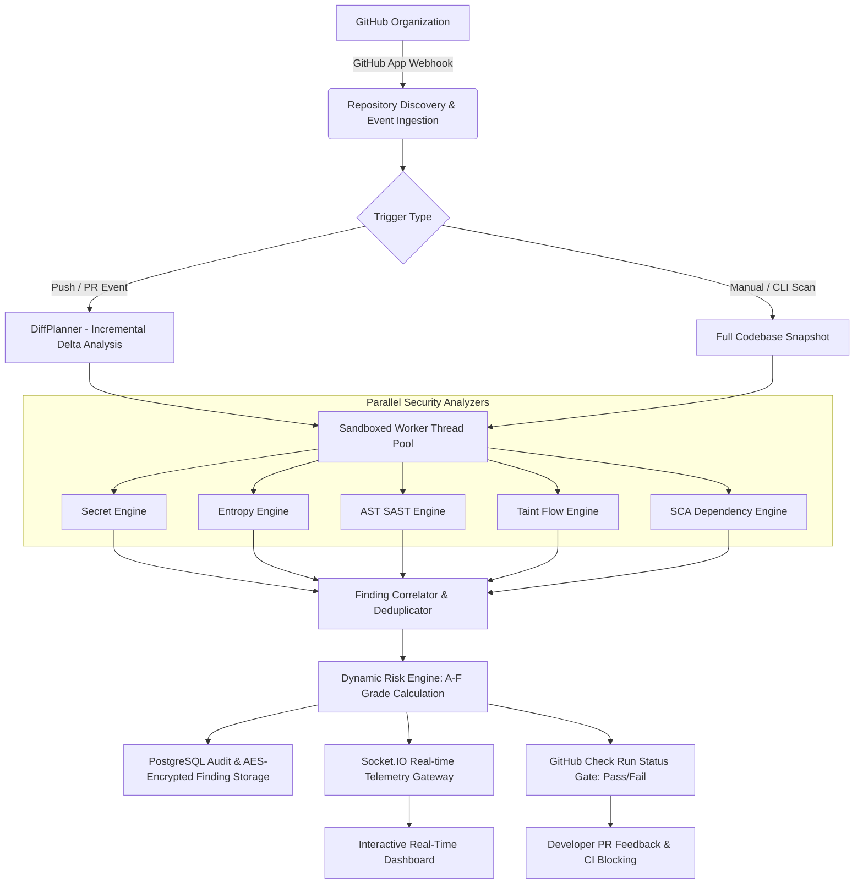
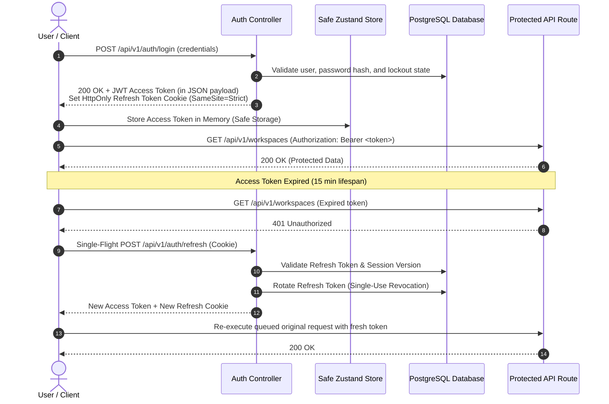

<div align="center">

# 🛡️ Oculus

### Enterprise GitHub Security & Continuous DevSecOps Intelligence Platform

[](https://nodejs.org/)
[](https://react.dev/)
[](https://www.typescriptlang.org/)
[](https://expressjs.com/)
[](https://www.postgresql.org/)
[](https://redis.io/)
[](https://tailwindcss.com/)
[](LICENSE)

<br />

**Continuous visibility into the security posture of every repository, every branch, and every commit.**

Oculus connects directly to your GitHub organization to discover codebases, run five specialized security analysis engines in sandboxed worker threads, compute real-time risk posture grades (**A** through **F**), and enforce automated security quality gates directly in CI/CD pipelines.

<br />

[🌐 Live Application](https://oculus-psi.vercel.app) • [📖 CLI Documentation](./cli/README.md) • [🐛 Report Bug](https://github.com/hashiraCoder/Oculus/issues) • [💡 Request Feature](https://github.com/hashiraCoder/Oculus/issues)

</div>

---

## 📑 Table of Contents

- [Overview](#-overview)
- [Key Capabilities](#-key-capabilities)
- [Architecture & Data Flow](#-architecture--data-flow)
- [Multi-Engine Security Suite](#-multi-engine-security-suite)
- [Security & Authentication Model](#-security--authentication-model)
- [Tech Stack](#-tech-stack)
- [Quick Start & Local Setup](#-quick-start--local-setup)
  - [Prerequisites](#prerequisites)
  - [1. Clone Repository](#1-clone-repository)
  - [2. Backend Setup](#2-backend-setup)
  - [3. Frontend Setup](#3-frontend-setup)
  - [4. CLI Setup](#4-cli-setup-optional)
- [REST API Reference](#-rest-api-reference)
- [CI/CD & Security Gates](#-cicd--security-gates)
- [Project Directory Structure](#-project-directory-structure)
- [Production Deployment](#-production-deployment)
- [Roadmap](#-roadmap)
- [Contributing Guidelines](#-contributing-guidelines)
- [License](#-license)

---

## 🔭 Overview

Modern software development demands security checks that run seamlessly within developer workflows without introducing bottleneck delays or false-positive fatigue. 

**Oculus** is an enterprise-grade DevSecOps platform engineered to deliver continuous security intelligence. By pairing native GitHub App webhooks with sandboxed, multi-threaded analysis engines, Oculus inspects code changes incrementally, correlates findings across multiple detection disciplines, and enforces automated pipeline gates with sub-second decision latency.



### 🛡️ Core Tenets & Guarantees

> [!IMPORTANT]
> **No Permanent Source Code Retention:** Source code is retrieved ephemerally into isolated worker sandboxes solely during scan execution and discarded immediately after AST evaluation. Source code is never retained in database storage.

> [!NOTE]
> **Zero-Disruption Engineering:** Oculus operates as an advisory and policy enforcement plane. It suggests actionable remediation code patches without committing unvetted changes directly to developer branches.

> [!TIP]
> **Strict Multi-Tenant Isolation:** Workspaces enforce cryptographic role scoping (`SUPER_ADMIN`, `ADMIN`, `MEMBER`, `VIEWER`), ensuring complete boundary separation across organizational repositories, API keys, and audit logs.

---

## ⚡ Key Capabilities

### 🔍 Multi-Engine Vulnerability Scanning
- **Five Concurrent Analysis Disciplines:** Regex, Shannon Entropy, Abstract Syntax Tree (AST), Taint Analysis, and Dependency Manifest scanning.
- **Sandboxed Thread Isolation:** Scans run inside dedicated Node.js `worker_threads` with enforceable execution timeouts and isolated memory heaps.
- **Incremental Diff Scanning (`DiffPlanner`):** Only changed files and dependent import graphs are analyzed on PR commits, providing rapid turnaround times.
- **Cross-Engine Finding Correlation:** Normalizes and merges overlapping alerts across analyzers into single actionable findings with deduplicated fingerprint hashes.
- **Shadow Scanning Mode:** Safely evaluate experimental rules and new analyzers side-by-side against production baselines before promoting them.

### 📊 Real-Time Posture & Analytics
- **Dynamic Risk Posture Grading (A–F):** Algorithmic scoring factoring in vulnerability severities, exploitability confidence, finding age, and workspace weights.
- **Interactive Security Telemetry:** Live streaming scan logs, progress bars, and audit records delivered over WebSockets (`Socket.IO`).
- **Developer Security Scorecards:** Trace vulnerability introduction trends and time-to-remediation across engineering teams.
- **Compliance Export:** Export filtered findings into structured **JSON**, **CSV**, or **SARIF** formats.

### 🔗 Deep GitHub & CI/CD Ecosystem Integration
- **Zero-Config GitHub App:** One-click OAuth install for complete organization repository synchronization.
- **Native Check Run Enforcement:** Blocks pull requests with critical vulnerabilities via automated GitHub commit status updates.
- **Headless Pipeline CLI (`@oculus/cli`):** Trigger scans, evaluate pass/fail criteria (`--wait`), and automate security quality gates in GitHub Actions, GitLab CI, or local terminals.

---

## 🏗️ Architecture & Data Flow

Oculus is engineered following a strict **layered clean architecture** with separation of concerns between presentation, orchestration, domain logic, and persistence.

```
┌────────────────────────────────────────────────────────────────────────┐
│                        PRESENTATION TIER (SPA)                         │
│       React 19  •  TypeScript  •  Tailwind CSS 4  •  Vite 8            │
│                                                                        │
│   Components  ──►  Custom Hooks  ──►  Repositories  ──►  Axios Client  │
│        ▲                                                     │         │
│   View Models  ◄──  Mappers  ◄──  DTO Interfaces  ◄──────────┘         │
└───────────────────────────────────┬────────────────────────────────────┘
                                    │ HTTPS (REST) / WSS (Socket.IO)
┌───────────────────────────────────▼────────────────────────────────────┐
│                         APPLICATION API GATEWAY                        │
│             Node.js  •  Express 5  •  Redis Pub/Sub                    │
│                                                                        │
│   Controllers  ──►  Business Services  ──►  Repositories  ──► Raw SQL  │
│        │                     │                                         │
│   Rate Limiting       Auth & JWT Session                               │
└──────────────────────────────┬─────────────────────────────────────────┘
                               │ BullMQ Job Enqueue
┌──────────────────────────────▼─────────────────────────────────────────┐
│                    DISTRIBUTED SCANNING WORKERS                        │
│             Node.js Worker Threads  •  Sandboxed Memory                │
│                                                                        │
│   ┌──────────────────────────────────────────────────────────────┐     │
│   │                 Parallel Analyzer Registry                   │     │
│   │  [Secret Engine]  [Entropy Engine]  [SAST Engine]            │     │
│   │  [Taint Analyzer] [SCA Dependency Graph Engine]              │     │
│   └──────────────────────────────┬───────────────────────────────┘     │
│                                  │                                     │
│                     Finding Correlator & Deduplicator                  │
│                                  │                                     │
│                     Risk Calculation Engine (A-F)                      │
└──────────────────────────────────┬─────────────────────────────────────┘
                                   │
┌──────────────────────────────────▼─────────────────────────────────────┐
│                       PERSISTENCE & CACHE TIER                         │
│   PostgreSQL 16 (Raw Parameterized SQL)  •  Redis 7 (Cache & BullMQ)   │
└────────────────────────────────────────────────────────────────────────┘
```

---

## 📡 Multi-Engine Security Suite

Each scan job evaluates target files against five complementary analysis engines:

| Engine | Technique | Target Scenarios & Detects | CWE Coverage |
|---|---|---|---|
| **Secret Engine** | RE2 High-Performance Regex | Hardcoded AWS credentials, GitHub personal tokens, Slack webhooks, Private RSA keys, JWT secrets, DB connection strings | CWE-798, CWE-259 |
| **Entropy Engine** | Shannon Entropy Metric | High-randomness cryptographic secrets, Base64 private blobs, obfuscated credentials lacking standard prefix patterns | CWE-312, CWE-321 |
| **SAST Engine** | Acorn AST Pattern Matcher | Code injection (`eval`, `Function`), prototype pollution, insecure deserialization, unsafe child processes, DOM-based XSS | CWE-94, CWE-1321, CWE-79 |
| **Taint Engine** | Source-to-Sink Dataflow DFG | Unsanitized HTTP inputs, request params, and headers propagating into database queries, shells, or HTML outputs | CWE-89, CWE-78, CWE-116 |
| **SCA Engine** | Dependency Tree Analysis | Known public CVEs across package manifests (`package.json`, `package-lock.json`, lockfiles) via security advisories | CWE-1395, CWE-1104 |

### Finding Enrichment & Lifecycle
Each finding generated across engines is normalized with:
- **Unique Fingerprint:** Deterministic SHA-256 hash calculated over file context to maintain identity across line additions and file shifts.
- **Severity Rating:** `CRITICAL`, `HIGH`, `MEDIUM`, `LOW`, or `INFO`.
- **Triage Workflow:** `OPEN` ➔ `CONFIRMED` ➔ `FALSE_POSITIVE` ➔ `FIXED` ➔ `IGNORED`.
- **AES-256 Code Snippet Encryption:** Sensitive source code excerpts are encrypted at rest in PostgreSQL.
- **Audit Logging:** Every status change records the reviewing engineer, rationale comment, and timestamp in `vulnerability_audits`.

---

## 🔒 Security & Authentication Model

Oculus implements an enterprise-grade, defense-in-depth security model:



- **Memory-Only Access Tokens:** 15-minute JSON Web Tokens are retained exclusively in active memory (never exposed in persistent `localStorage`).
- **Single-Flight Refresh Rotation (RTR):** Axios response interceptors coalesce simultaneous 401 responses into a single refresh flight, eliminating concurrency race conditions.
- **Global Invalidation (`logout-all`):** Incrementing the user's `token_version` in PostgreSQL instantly revokes every active access and refresh token globally.
- **Developer Token Scopes:** Granular automation tokens (`ocx_live_...`) hashed with SHA-256, strictly restricted to explicit scopes (`scans:create`, `findings:read`, `analytics:read`).
- **Resilient Storage Fallbacks:** All client storage access is wrapped with `safeSessionStorage` and `safeLocalStorage`, falling back to in-memory mocks when running inside privacy-hardened browsers or cross-origin iframes.

---

## 🛠️ Tech Stack

### Frontend Architecture
| Category | Technology | Purpose |
|---|---|---|
| **Framework** | [React 19](https://react.dev/) | Component architecture & modern React features |
| **Language** | [TypeScript 6](https://www.typescriptlang.org/) | Type safety across viewmodels, DTOs, and stores |
| **Styling** | [Tailwind CSS 4](https://tailwindcss.com/) | Design tokens and responsive layouts |
| **Build Tool** | [Vite 8](https://vite.dev/) | Development server and bundle optimizer |
| **State Management** | [Zustand 5](https://zustand.docs.pmnd.rs/) | Lightweight global stores for auth, workspace, and layout |
| **Server Cache** | [TanStack React Query v5](https://tanstack.com/query) | Declarative fetching, caching, and cache invalidation |
| **Data Tables** | [TanStack Table v8](https://tanstack.com/table) + [Virtual v3](https://tanstack.com/virtual) | Virtualized row rendering for high-volume finding tables |
| **Visualizations** | [Recharts v3](https://recharts.org/) | Risk dials, severity distributions, and trend charts |
| **Form Handling** | [React Hook Form](https://react-hook-form.com/) + [Zod](https://zod.dev/) | Schema-driven form validation and runtime typing |
| **Real-Time** | [Socket.IO Client v4](https://socket.io/) | Bi-directional streaming for scan progress and notifications |

### Backend Architecture
| Category | Technology | Purpose |
|---|---|---|
| **Runtime** | [Node.js](https://nodejs.org/) (≥18 LTS) | Event-driven backend execution environment |
| **Web Server** | [Express 5](https://expressjs.com/) | Versioned RESTful API router (`/api/v1`) |
| **Database** | [PostgreSQL 16](https://www.postgresql.org/) | Relational database (Raw parameterized SQL, strict Zero-ORM) |
| **In-Memory & Cache** | [Redis 7](https://redis.io/) (`ioredis`) | Fast caching, rate limit stores, and pub/sub channels |
| **Job Queue** | [BullMQ v5](https://docs.bullmq.io/) | Distributed job queues for scans and background notifications |
| **Parsing & AST** | [Acorn](https://github.com/acornjs/acorn) + [RE2](https://github.com/google/re2) | AST generation and linear-time regular expression evaluation |
| **Real-Time Server** | [Socket.IO v4](https://socket.io/) | WebSocket server for workspace rooms and scan channels |
| **CLI Framework** | [Commander.js v12](https://github.com/tj/commander.js/) | CLI argument parsing, status exit codes, and terminal UI |

---


### CLI Setup 

To test the command-line interface locally:

```bash
cd ../cli
npm install
npm link

# Verify installation
oculus --version

# Authenticate with a Developer Token
oculus auth login --token ocx_live_your_generated_token
oculus auth status
```

---

## 📡 REST API Reference

All versioned endpoints are prefixed with `/api/v1`.

### 🩺 Health & Diagnostics
| Method | Endpoint | Description | Auth Required |
|---|---|---|:---:|
| `GET` | `/liveness` | Service liveness probe | No |
| `GET` | `/health` | Core subsystem health (DB, Redis, Memory) | No |
| `GET` | `/readiness` | Worker queue readiness check | No |

### 🔐 Authentication & Session Management
| Method | Endpoint | Description | Auth Required |
|---|---|---|:---:|
| `POST` | `/auth/register` | Register new account & default workspace | No |
| `POST` | `/auth/login` | Authenticate with email & password | No |
| `POST` | `/auth/refresh` | Rotate refresh token and issue new JWT | Cookie |
| `POST` | `/auth/logout` | Revoke current device session | Yes |
| `POST` | `/auth/logout-all` | Increment token version, revoking all devices | Yes |

### 🏢 Workspaces & Configuration
| Method | Endpoint | Description | Auth Required |
|---|---|---|:---:|
| `GET` | `/workspaces` | Retrieve all workspaces accessible to user | Yes |
| `GET` | `/workspaces/:id` | Fetch detailed workspace profile | Yes |
| `PATCH` | `/workspaces/:id` | Rename workspace or update policies | Yes (Admin) |
| `GET` | `/workspaces/:id/tokens` | List developer API tokens | Yes |
| `POST` | `/workspaces/:id/tokens` | Generate new scoped developer token | Yes (Admin) |

### 🔍 Security Scans & Telemetry
| Method | Endpoint | Description | Auth Required |
|---|---|---|:---:|
| `POST` | `/scans` | Dispatch new scan job for a repository | Yes |
| `GET` | `/scans/:id` | Get status, metrics, and progress of scan | Yes |
| `GET` | `/scans/:id/logs` | Fetch terminal execution logs | Yes |
| `GET` | `/scans/:id/gate` | Evaluate CI/CD security quality gate | Token / Key |
| `POST` | `/scans/:id/cancel` | Abort an active in-flight scan | Yes |

### 📋 Findings & Vulnerability Triage
| Method | Endpoint | Description | Auth Required |
|---|---|---|:---:|
| `GET` | `/findings/:wsId` | Paginated list of workspace findings with filters | Yes |
| `GET` | `/findings/:wsId/:id` | Fetch finding details & encrypted snippet | Yes |
| `PATCH` | `/findings/:wsId/:id/status` | Transition status (`CONFIRMED`, `FALSE_POSITIVE`, etc.) | Yes |
| `PATCH` | `/findings/:wsId/bulk-status` | Bulk update status across multiple findings | Yes |
| `GET` | `/findings/:wsId/:id/audit` | Retrieve full chronological audit trail | Yes |

---

## 🚦 CI/CD & Security Gates

Oculus can be dropped into any continuous integration pipeline as an automated pull request security gate.

### GitHub Actions Workflow Example

Create `.github/workflows/oculus-security.yml` in your target repository:

```yaml
name: Oculus Security Quality Gate

on:
  push:
    branches: [ main, develop ]
  pull_request:
    branches: [ main ]

jobs:
  security-gate:
    name: Run Oculus Scanner
    runs-on: ubuntu-latest

    steps:
      - name: Checkout Source Code
        uses: actions/checkout@v4
        with:
          fetch-depth: 0

      - name: Setup Node.js
        uses: actions/setup-node@v4
        with:
          node-version: 20

      - name: Install Oculus CLI
        run: npm install -g @oculus/cli

      - name: Execute Security Gate
        env:
          OCULUS_API_URL: ${{ secrets.OCULUS_API_URL }}
          OCULUS_TOKEN: ${{ secrets.OCULUS_DEVELOPER_TOKEN }}
        run: |
          oculus scan \
            --workspace "${{ secrets.OCULUS_WORKSPACE_ID }}" \
            --repo "${{ github.repository }}" \
            --commit "${{ github.sha }}" \
            --wait \
            --fail-on high
```

If critical or high vulnerabilities are detected, `oculus scan --wait` exits with code `1`, preventing pull request merges until vulnerabilities are resolved or formally triaged.

---

## 📁 Project Directory Structure

<details>
<summary>📂 Click to inspect monorepo file structure</summary>

```
Oculus/
├── Backend/
│   ├── admin/                  # Super Admin engine observatory & queues
│   ├── analytics/              # Security posture metrics & risk trend calculators
│   ├── auth/                   # Identity, password hashing, and token services
│   ├── config/                 # Typed 12-factor env configuration & Winston logger
│   ├── database/               # Database bootstrap, seeds, and SQL migrations
│   │   ├── schema/             # DDL table schemas (users, scans, findings, audits)
│   │   └── migrations/         # Sequential SQL patch migrations
│   ├── email/                  # Notification providers (Brevo, SMTP, Resend)
│   ├── findings/               # Finding triage, export, and query services
│   ├── github/                 # GitHub App OAuth, webhooks, and Check Runs
│   ├── middleware/             # Express auth guards, rate limiters, error handler
│   ├── notifications/          # Socket.IO gateway and Redis subscriber events
│   ├── pagination/             # Keyset-based cursor pagination utility
│   ├── queues/                 # BullMQ queue creators and worker schedulers
│   ├── repositories/           # Zero-ORM raw SQL queries with connection pooling
│   ├── routes/                 # Express route definitions mounted on /api/v1
│   ├── scanner/
│   │   ├── engines/            # Secret, Entropy, SAST, Taint, and SCA analyzers
│   │   ├── orchestrator/       # Scan lifecycle state machine & correlator
│   │   ├── sandbox/            # Worker thread boundary with memory guards
│   │   └── policies/           # Configurable severity weight definitions
│   ├── security/               # Algorithmic A-F posture grade calculator
│   ├── workers/                # BullMQ background workers (Scan, Outbox, Baseline)
│   └── workspaces/             # Multi-tenant workspace isolation management
│
├── Frontend/
│   └── src/
│       ├── app/                # Root App component and Tailwind design tokens
│       ├── components/
│       │   ├── layout/         # Top navigation, Sidebar, Notifications popover
│       │   ├── security/       # Severity badges, Risk dials, Status chips
│       │   ├── shared/         # Production ErrorBoundary, loading skeletons
│       │   └── ui/             # Accessible UI primitives (Button, Dialog, Card)
│       ├── features/
│       │   ├── analytics/      # Visual trend charts and distribution breakdowns
│       │   ├── auth/           # Login, register, and token refresh hooks
│       │   ├── dashboard/      # Executive posture dashboard
│       │   ├── developers/     # Developer leaderboard & security metrics
│       │   ├── export/         # SARIF, CSV, JSON streaming export controls
│       │   ├── findings/       # Virtualized finding table & triage drawer
│       │   ├── github/         # Organization repo synchronization panel
│       │   ├── health/         # System diagnostic telemetry cards
│       │   ├── repositories/   # Monitored repository catalog
│       │   ├── scans/          # Live terminal output and scan telemetry
│       │   └── settings/       # Workspace config & Developer API Token CRUD
│       ├── layouts/            # AuthLayout and DashboardLayout wrappers
│       ├── lib/                # Safe storage, date safety, and Axios interceptor
│       ├── providers/          # QueryClient, Socket, and Theme providers
│       ├── router/             # React Router with protected workspace routes
│       └── stores/             # Safe Zustand stores (Auth, Workspace, UI)
│
├── cli/
│   ├── bin/oculus.js           # CLI executable binary
│   ├── src/
│   │   ├── commands/           # auth, scan, findings, repo, config commands
│   │   └── utils/              # Terminal formatters, HTTP client, exit codes
│   └── ci/                     # Reusable CI workflow templates
└── 
```

</details>

---

## 🌐 Production Deployment

| Component | Target Platform | Deployment Command / Hook | Notes |
|---|---|---|---|
| **Frontend** | [Vercel](https://vercel.com/) | `cd Frontend && vercel --prod` | Built with Vite. Static asset routing configured with SPA fallbacks. |
| **Backend API** | [Render](https://render.com/) | `npm run start` (Node Web Service) | Auto-deploys from `main` branch. Integrated with health check probes. |
| **Database** | [Supabase](https://supabase.com/) | Parameterized PostgreSQL connection | Multi-AZ managed PostgreSQL instance with connection pooling. |
| **Redis Cache** | [Upstash](https://upstash.com/) | Secure TLS connection (`rediss://`) | Serverless Redis for distributed queues and Socket.IO adapter. |
| **CLI Tool** | [npm](https://www.npmjs.com/) | `npm publish --access public` | Globally distributable CLI package `@oculus/cli`. |

---

## 🗺️ Roadmap

- [x] Multi-engine vulnerability scanner (Secret, Entropy, SAST, Taint, Dependency)
- [x] Sandboxed worker thread execution with execution timeouts
- [x] Incremental PR diff scanning with `DiffPlanner`
- [x] Zero-config GitHub App integration with Check Runs
- [x] Real-time posture dashboard with dynamic A–F grading
- [x] Single-flight refresh token rotation with memory-only access tokens
- [x] Resilient cross-browser storage with safe in-memory fallback
- [x] Headless CI/CD scanner CLI (`@oculus/cli`) with exit status gates
- [x] Full finding triage audit trails with encrypted code evidence
- [x] Shadow scan comparison engine for new analyzer rule promotion
- [ ] Automated scheduled baseline scans on inactive repositories
- [ ] In-browser custom AST query authoring interface
- [ ] Single Sign-On (SAML / OIDC / Okta) integration
- [ ] Slack, Discord, and Microsoft Teams incident webhooks
- [ ] Automatic PR inline comments on vulnerable lines of code

---

## 🤝 Contributing Guidelines

Contributions are welcome! Please ensure that all changes adhere to Oculus's architectural boundaries:

1. **Fork the Repository:** Create your topic branch (`git checkout -b feature/analyzer-enhancement`).
2. **Commit Changes:** Adhere to conventional commit standards (`git commit -m 'feat: add support for rust cargo lockfile'`).
3. **Preserve Architectural Invariants:**
   - Presentation components must **never** call HTTP libraries directly — all calls flow through repositories and React Query hooks.
   - Database operations in the backend must **never** use ORMs — write clear, parameterized SQL.
   - Access tokens must **never** be placed in persistent `localStorage`.
4. **Run Verification Suites:**
   ```bash
   # In Backend/
   npm test
   
   # In Frontend/
   npm run build
   npm run lint
   ```
5. **Open a Pull Request:** Describe the rationale, testing steps, and security impact.

---

## 📄 License

This project is licensed under the **ISC License**. See the [LICENSE](LICENSE) file for details.

---

<div align="center">

**Built with 🛡️ for engineering teams who take code security seriously.**

[Website](https://oculus-psi.vercel.app) • [GitHub Repository](https://github.com/hashiraCoder/Oculus) • [Issues](https://github.com/hashiraCoder/Oculus/issues)

</div>
