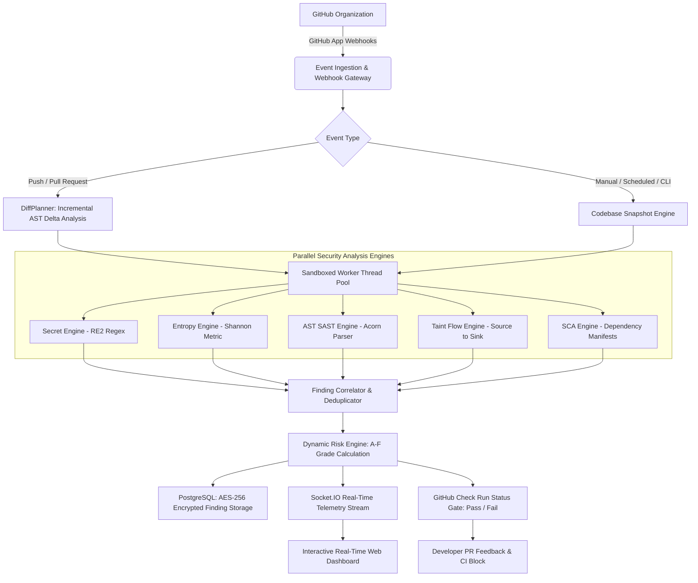
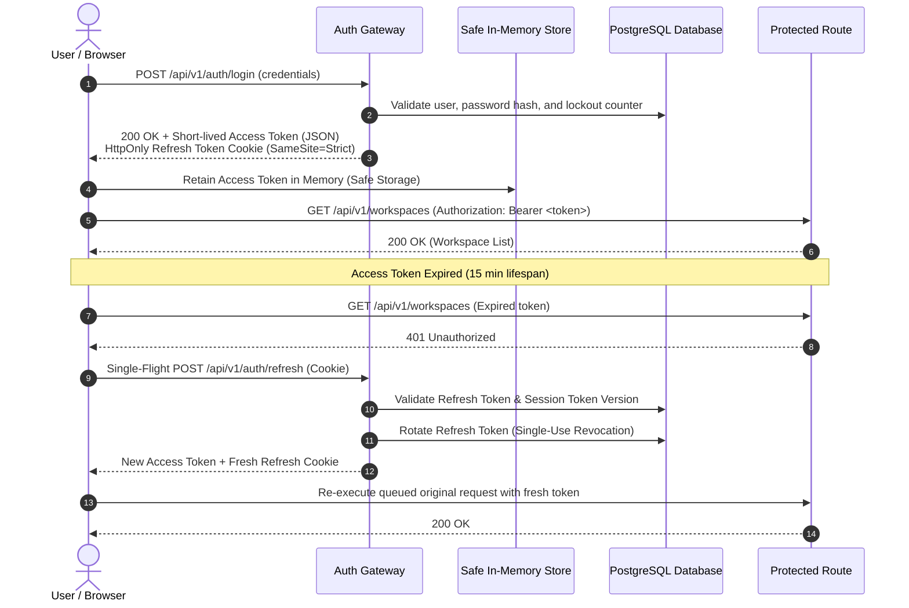

<div align="center">

# 🛡️ Oculus

### Continuous DevSecOps Intelligence & Automated Security Quality Gates for GitHub

[](https://nodejs.org/)
[](https://react.dev/)
[](https://www.typescriptlang.org/)
[](https://expressjs.com/)
[](https://www.postgresql.org/)
[](https://redis.io/)
[](https://tailwindcss.com/)
[](LICENSE)

<br />

**Continuous, real-time security visibility into every repository, branch, and pull request.**

Oculus connects seamlessly to your GitHub organization to discover codebases, run five specialized security analysis engines in sandboxed worker threads, compute real-time risk posture grades (**A** through **F**), and enforce automated security quality gates directly within CI/CD pipelines.

<br />

[🌐 Live Demo](https://oculus-psi.vercel.app) • [📖 Documentation](#Evidence) • [⚡ Quick Start](#-quick-start--local-setup) • [🐛 Report Issue](https://github.com/hashiraCoder/Oculus/issues) • [💡 Request Feature](https://github.com/hashiraCoder/Oculus/issues)

</div>

---

## 📑 Table of Contents

- [Overview](#-overview)
- [Key Features](#-key-features)
- [Multi-Engine Security Suite](#-multi-engine-security-suite)
- [Architecture & Data Flow](#-architecture--data-flow)
- [Security & Cryptographic Guarantees](#-security--cryptographic-guarantees)
- [Tech Stack](#-tech-stack)
- [Quick Start & Local Setup](#-quick-start--local-setup)
  - [Prerequisites](#prerequisites)
  - [1. Clone Repository](#1-clone-repository)
  - [2. Backend Setup](#2-backend-setup)
  - [3. Frontend Setup](#3-frontend-setup)
  - [4. CLI Setup](#4-cli-setup-optional)
- [CI/CD & Pipeline Quality Gates](#-cicd--pipeline-quality-gates)
- [Headless CLI Reference](#-headless-cli-reference)
- [REST API Reference](#-rest-api-reference)
- [Repository Structure](#-repository-structure)
- [Roadmap](#-roadmap)
- [Contributing Guidelines](#-contributing-guidelines)
- [License](#-license)

---

## 🔭 Overview

Modern development teams ship fast, but traditional application security testing tools are often slow, noisy, and siloed from daily developer workflows. 

**Oculus** bridges the gap between speed and security. Operating as an intelligent DevSecOps control plane, Oculus continuously evaluates your repositories through native GitHub webhooks, triggers incremental scans with sub-second decision latency, correlates findings across multiple detection disciplines, and enforces strict security policies before vulnerable code merges to production.



### 🛡️ Core Guarantees

> [!IMPORTANT]
> **Ephemeral Zero-Retention Scanning:** Source code is streamed ephemerally into isolated worker sandboxes solely for the duration of AST evaluation. Raw code is **never persisted** to databases or disk.

> [!NOTE]
> **Zero Disruption for Engineers:** Oculus operates non-intrusively. It surfaces actionable remediation suggestions, code snippets, and advisory PR statuses without introducing merge friction or modifying developer branches directly.

> [!TIP]
> **Enterprise Multi-Tenancy:** Workspaces enforce strict cryptographic role-based access control (`SUPER_ADMIN`, `ADMIN`, `MEMBER`, `VIEWER`), ensuring complete isolation across repositories, API tokens, and compliance audit records.

---

## ⚡ Key Features

### 🔍 Comprehensive Security Engines
- **Five Parallel Analyzers:** High-speed regex pattern matching, Shannon entropy calculation, Abstract Syntax Tree (AST) static analysis, taint dataflow tracking, and Software Composition Analysis (SCA).
- **Sandboxed Worker Threads:** Analyzers execute inside isolated Node.js `worker_threads` with enforceable CPU timeouts and strict memory boundaries.
- **Incremental PR Scanning (`DiffPlanner`):** Analyzes only modified files and dependent import trees on pull requests, cutting scan times from minutes to seconds.
- **Deterministic Finding Fingerprints:** Finds are assigned deterministic SHA-256 context hashes, ensuring findings retain their lifecycle history across line additions and file refactors.
- **Shadow Scanning Mode:** Test new analyzer rules and experimental heuristics side-by-side against production baselines before full promotion.

### 📊 Real-Time Posture & Analytics
- **Dynamic Risk Posture Grading (A–F):** Algorithmic scoring that dynamically weighs vulnerability severities, confidence levels, finding age, and workspace criticality.
- **Live Telemetry & Streaming Logs:** Scan execution progress, terminal logs, and system metrics broadcast via WebSocket (`Socket.IO`).
- **Engineering Scorecards:** Track remediation velocity, recurring vulnerability patterns, and historical team posture trends.
- **Multi-Format Compliance Export:** Export normalized finding sets directly to **SARIF**, **JSON**, or **CSV** formats for SIEM and reporting ingestion.

### 🔗 Native Developer Ecosystem
- **GitHub App Integration:** One-click repository discovery, synchronized webhook handling, and automated GitHub Check Runs.
- **Automated Pull Request Blocking:** Fails CI status checks when new Critical or High vulnerabilities are introduced.
- **Headless Pipeline CLI (`@oculus/cli`):** Scriptable CLI for local pre-commit checks and CI/CD pipelines (GitHub Actions, GitLab CI, CircleCI).

---

## 📡 Multi-Engine Security Suite

Every scan passes code through five specialized, non-interfering detection engines:

| Engine | Detection Technique | Primary Target Scenarios | CWE Coverage |
|---|---|---|---|
| **Secret Engine** | RE2 High-Performance Regex | AWS access keys, GitHub tokens, Slack webhooks, RSA private keys, JWT secrets, DB connection URLs | CWE-798, CWE-259 |
| **Entropy Engine** | Shannon Entropy Calculation | High-randomness cryptographic secrets, Base64 private keys, high-entropy tokens without standard prefixes | CWE-312, CWE-321 |
| **SAST Engine** | Acorn AST Pattern Matching | Code injection (`eval`, `Function`), prototype pollution, insecure deserialization, unsafe child process execution, DOM XSS | CWE-94, CWE-1321, CWE-79 |
| **Taint Engine** | Source-to-Sink Dataflow Graphs | Untrusted HTTP inputs, headers, and request parameters propagating into SQL queries, shells, or HTML sinks | CWE-89, CWE-78, CWE-116 |
| **SCA Engine** | Dependency Tree & Advisory Match | Known public CVEs in dependency manifests (`package.json`, `package-lock.json`, lockfiles) | CWE-1395, CWE-1104 |

### Finding Enrichment & Lifecycle

```
[ New Finding ] ──► [ Deduplication & Hashing ] ──► [ AES-256 Encryption ] ──► [ Open ]
                                                                                   │
                 ┌─────────────────────────────────────────────────────────────────┴──────────┐
                 ▼                                 ▼                                          ▼
          [ Confirmed ]                   [ False Positive ]                             [ Ignored ]
                 │                                 │                                          │
                 ▼                                 └──────────────────┬───────────────────────┘
            [ Fixed ]                                                 ▼
                                                              [ Complete Audit Trail ]
```

- **Fingerprint Consistency:** Deterministic SHA-256 fingerprint calculated over the syntactic context.
- **Standardized Severity Tiers:** `CRITICAL`, `HIGH`, `MEDIUM`, `LOW`, and `INFO`.
- **Triage State Machine:** `OPEN` ➔ `CONFIRMED` ➔ `FALSE_POSITIVE` ➔ `FIXED` ➔ `IGNORED`.
- **Snippet Protection:** Sensitive source code snippets are encrypted at rest with AES-256 in the database.
- **Immutable Audit Trail:** All triage status modifications record the reviewer, rationale comment, and timestamp.

---

## 🏗️ Architecture & Data Flow

Oculus follows a clean, layered architecture separating user interface, orchestration, scanning engines, and persistence:

```
┌────────────────────────────────────────────────────────────────────────┐
│                        PRESENTATION LAYER (SPA)                        │
│          React 19  •  TypeScript  •  Tailwind CSS 4  •  Vite 8         │
│                                                                        │
│   Components  ──►  Custom Hooks  ──►  Repositories  ──►  Axios Client  │
│        ▲                                                     │         │
│   View Models  ◄──  Mappers  ◄──  DTO Interfaces  ◄──────────┘         │
└───────────────────────────────────┬────────────────────────────────────┘
                                    │ HTTPS (REST) / WSS (Socket.IO)
┌───────────────────────────────────▼────────────────────────────────────┐
│                         APPLICATION API GATEWAY                        │
│             Node.js  •  Express 5  •  Redis Pub/Sub                    │
│                                                                        │
│   Controllers  ──►  Business Services  ──►  Repositories  ──► Raw SQL  │
│        │                     │                                         │
│   Rate Limiting       Auth & Session Guard                             │
└──────────────────────────────┬─────────────────────────────────────────┘
                               │ BullMQ Task Queue
┌──────────────────────────────▼─────────────────────────────────────────┐
│                    DISTRIBUTED SCANNING WORKERS                        │
│             Node.js Worker Threads  •  Sandboxed Memory                │
│                                                                        │
│   ┌──────────────────────────────────────────────────────────────┐     │
│   │                 Parallel Analyzer Registry                   │     │
│   │  [Secret Engine]  [Entropy Engine]  [SAST Engine]            │     │
│   │  [Taint Analyzer] [SCA Dependency Graph Engine]              │     │
│   └──────────────────────────────┬───────────────────────────────┘     │
│                                  │                                     │
│                     Finding Correlator & Deduplicator                  │
│                                  │                                     │
│                     Risk Calculation Engine (A-F)                      │
└──────────────────────────────────┬─────────────────────────────────────┘
                                   │
┌──────────────────────────────────▼─────────────────────────────────────┐
│                       PERSISTENCE & CACHING TIER                       │
│    PostgreSQL 16 (Parameterized SQL)  •  Redis 7 (BullMQ & Caching)    │
└────────────────────────────────────────────────────────────────────────┘
```

---

## 🔒 Security & Cryptographic Guarantees

Oculus is designed according to enterprise defense-in-depth principles:



- **Memory-Only Access Tokens:** Short-lived (15 min) JWTs are stored in active application memory—never in `localStorage`.
- **Single-Flight Refresh Token Rotation (RTR):** Coalesces concurrent 401 requests into a single refresh handshake, preventing race-condition lockouts.
- **Global Session Invalidation:** Incrementing a user's `token_version` immediately revokes active sessions across all devices.
- **Granular Developer Tokens:** Scoped machine tokens (`ocx_live_...`) hashed with SHA-256 for secure pipeline access.
- **Resilient Storage Fallbacks:** Automatic in-memory mock fallback when running inside hardened or cross-origin sandbox environments.

---

## 🛠️ Tech Stack

### Frontend
| Tool | Version | Purpose |
|---|---|---|
| **React** | 19.x | Modern UI rendering and concurrent features |
| **TypeScript** | 6.x | Strict type safety for DTOs, view models, and stores |
| **Tailwind CSS** | 4.x | Design system tokens and responsive layouts |
| **Vite** | 8.x | High-speed ESM development and production bundler |
| **Zustand** | 5.x | High-performance state stores for auth and workspaces |
| **TanStack Query** | v5 | Declarative server data fetching and cache invalidation |
| **TanStack Table & Virtual** | v8 / v3 | Virtualized table rendering for high-volume finding sets |
| **Recharts** | v3 | Posture dials, severity breakdowns, and trend charts |
| **Socket.IO Client** | v4 | WebSocket listener for real-time scan progress |

### Backend
| Tool | Version | Purpose |
|---|---|---|
| **Node.js** | ≥ 18 LTS | Asynchronous runtime environment |
| **Express** | 5.x | Scalable REST API gateway (`/api/v1`) |
| **PostgreSQL** | 16 | Relational persistence with raw parameterized SQL |
| **Redis** | 7.x | Fast caching, rate limit stores, and pub/sub channels |
| **BullMQ** | v5 | Robust distributed job queue for scan orchestration |
| **Acorn & Acorn Walk** | 8.x | JavaScript / TypeScript AST parsing and AST traversal |
| **RE2** | 1.x | Safe, linear-time regular expression engine (ReDoS-immune) |
| **Socket.IO** | v4 | WebSocket server for scan telemetry and live events |
| **Commander.js** | v12 | CLI tool framework for pipeline integration |

---

## 🚀 Quick Start & Local Setup

### Prerequisites

Ensure you have the following installed locally:
- **Node.js** `≥ 18.0.0`
- **npm** `≥ 9.0.0`
- **PostgreSQL** `≥ 14` (Local or cloud managed, e.g., Supabase / Neon)
- **Redis** `≥ 6` (Local or serverless, e.g., Upstash)
- *(Optional)* A registered **GitHub App** for live repository webhook synchronization

---

### 1. Clone Repository

```bash
git clone https://github.com/hashiraCoder/Oculus.git  -->(restricted please contact owner)
cd Oculus
```

---

### 2. Backend Setup

```bash
cd Backend
npm install
cp .env.example .env
```

Configure your environment variables in `Backend/.env`:

```env
# ── Server Configuration ──
PORT=3000
NODE_ENV=development
CORS_URL=http://localhost:5173

# ── PostgreSQL Database ──
DB_HOST=127.0.0.1
DB_PORT=5432
DB_USER=db_user_name
DB_PASSWORD=your_secure_password
DB_NAME=db_name
DB_MAX_POOL_SIZE=20

# ── Redis Cache & BullMQ Queue ──
REDIS_URL=redis://127.0.0.1:6379

# ── JWT Authentication ──
JWT_SECRET=replace_with_min_32_character_random_string
JWT_REFRESH_SECRET=replace_with_min_32_character_random_string
JWT_ACCESS_EXPIRES_IN=15m
JWT_REFRESH_EXPIRES_IN=7d

# ── Encryption & Scanner Controls ──
FINDING_ENCRYPTION_KEY=replace_with_32_byte_aes_encryption_key
SCANNER_TIMEOUT_MS=30000
SCANNER_CONCURRENCY=2

```

Initialize the database schema and launch the development server:

```bash
# Run database schema migrations
npm run db:migrate

# Start the backend server with hot-reload
npm run dev
```

The API will be available at `http://localhost:3000/api/v1`.

---

### 3. Frontend Setup

In a new terminal window:

```bash
cd Frontend
npm install
```

Create a `.env.local` file:

```env
VITE_API_URL=http://localhost:3000/api/v1
VITE_GITHUB_APP_NAME=oculus-security-scanner
```

Start the Vite development server:

```bash
npm run dev
```

Open your browser to `http://localhost:5173` to access the Oculus dashboard.

---

### 4. CLI Setup (Optional)

To test the command-line interface locally:

```bash
cd cli
npm install
npm link

# Verify installation
oculus --version

# Authenticate with your developer token
oculus auth login --token ocx_live_your_token_here
oculus auth status
```

---

## 🚦 CI/CD & Pipeline Quality Gates

Integrate Oculus directly into your GitHub Actions workflow to block pull requests containing critical vulnerabilities.

### GitHub Actions Workflow Example

Create `.github/workflows/oculus-security.yml` in your target repository:

```yaml
name: Oculus Security Quality Gate

on:
  push:
    branches: [ main, develop ]
  pull_request:
    branches: [ main ]

jobs:
  security-gate:
    name: Run Oculus Security Scanner
    runs-on: ubuntu-latest

    steps:
      - name: Checkout Code
        uses: actions/checkout@v4
        with:
          fetch-depth: 0

      - name: Setup Node.js
        uses: actions/setup-node@v4
        with:
          node-version: 20

      - name: Install Oculus CLI
        run: npm install -g @oculus/cli

      - name: Execute Security Gate
        env:
          OCULUS_API_URL: ${{ secrets.OCULUS_API_URL }}
          OCULUS_TOKEN: ${{ secrets.OCULUS_DEVELOPER_TOKEN }}
        run: |
          oculus scan \
            --workspace "${{ secrets.OCULUS_WORKSPACE_ID }}" \
            --repo "${{ github.repository }}" \
            --commit "${{ github.sha }}" \
            --wait \
            --fail-on high
```

> If vulnerabilities at or above `--fail-on` are detected, `oculus scan --wait` exits with code `1`, preventing pull request merges until resolved.

---

## 💻 Headless CLI Reference

The `@oculus/cli` binary provides comprehensive pipeline control:

```bash
# Authenticate CLI with workspace token
oculus auth login --token <DEVELOPER_TOKEN>
oculus auth status

# Trigger an immediate scan
oculus scan --repo <owner/repo> --commit <sha>

# Trigger scan and wait for quality gate evaluation
oculus scan --repo <owner/repo> --commit <sha> --wait --fail-on high

# Query workspace findings
oculus findings list --severity CRITICAL --status OPEN

# View monitored repositories
oculus repo list
```

---

## 📡 REST API Reference

All versioned endpoints are prefixed with `/api/v1`.

### 🩺 Health & Diagnostics
| Method | Endpoint | Description | Auth Required |
|---|---|---|:---:|
| `GET` | `/liveness` | Service liveness probe | No |
| `GET` | `/health` | Core subsystem health (PostgreSQL, Redis, Memory) | No |
| `GET` | `/readiness` | Job worker queue readiness probe | No |

### 🔐 Authentication & Session
| Method | Endpoint | Description | Auth Required |
|---|---|---|:---:|
| `POST` | `/auth/register` | Register new account and workspace | No |
| `POST` | `/auth/login` | Authenticate with credentials | No |
| `POST` | `/auth/refresh` | Rotate refresh token and issue fresh JWT | HttpOnly Cookie |
| `POST` | `/auth/logout` | Terminate active device session | Yes |
| `POST` | `/auth/logout-all` | Invalidate all sessions globally | Yes |

### 🏢 Workspaces & Tokens
| Method | Endpoint | Description | Auth Required |
|---|---|---|:---:|
| `GET` | `/workspaces` | List accessible user workspaces | Yes |
| `GET` | `/workspaces/:id` | Workspace details and security policies | Yes |
| `GET` | `/workspaces/:id/tokens` | List scoped developer API tokens | Yes |
| `POST` | `/workspaces/:id/tokens` | Create a new scoped developer API token | Yes (Admin) |

### 🔍 Scans & Telemetry
| Method | Endpoint | Description | Auth Required |
|---|---|---|:---:|
| `POST` | `/scans` | Dispatch a repository scan job | Yes |
| `GET` | `/scans/:id` | Scan status, timing, and progress metrics | Yes |
| `GET` | `/scans/:id/logs` | Execution log output stream | Yes |
| `GET` | `/scans/:id/gate` | CI/CD security quality gate evaluation | Token / Key |
| `POST` | `/scans/:id/cancel` | Cancel an in-flight scan | Yes |

### 📋 Findings & Triage
| Method | Endpoint | Description | Auth Required |
|---|---|---|:---:|
| `GET` | `/findings/:wsId` | Paginated list of findings with filters | Yes |
| `GET` | `/findings/:wsId/:id` | Detailed finding view & decrypted snippet | Yes |
| `PATCH` | `/findings/:wsId/:id/status` | Triage status update (`CONFIRMED`, `FALSE_POSITIVE`, etc.) | Yes |
| `GET` | `/findings/:wsId/:id/audit` | Chronological audit trail for finding | Yes |

---

## 📁 Repository Structure

```
Oculus/
├── Backend/                    # Node.js Express 5 REST API & Scan Orchestrator
│   ├── admin/                  # Super-admin observatory and health telemetry
│   ├── analytics/              # Risk trend models and posture calculators
│   ├── auth/                   # Identity, password hashing, and token services
│   ├── config/                 # Environment configuration & Winston logger
│   ├── database/               # PostgreSQL schemas and versioned SQL migrations
│   ├── email/                  # Notification providers (Brevo, SMTP, Resend)
│   ├── findings/               # Finding triage, export (SARIF/CSV), and queries
│   ├── github/                 # GitHub App integration, webhooks, and Check Runs
│   ├── middleware/             # Auth guards, rate limiting, and error handling
│   ├── notifications/          # Socket.IO gateway and Redis event subscribers
│   ├── queues/                 # BullMQ queue creators and worker schedulers
│   ├── repositories/           # Zero-ORM parameterized SQL repositories
│   ├── routes/                 # Express REST route controllers (/api/v1)
│   ├── scanner/                # Security analysis engines, sandbox, and policies
│   └── workers/                # BullMQ background job workers
│
├── Frontend/                   # React 19 Single Page Application
│   └── src/
│       ├── components/         # Layout, UI primitives, and security widgets
│       ├── features/           # Dashboard, findings, scans, analytics, settings
│       ├── layouts/            # Auth and Dashboard layout wrappers
│       ├── lib/                # Safe storage, Axios interceptors, date utils
│       ├── providers/          # React Query, Theme, and Socket.IO providers
│       ├── router/             # React Router route hierarchy
│       └── stores/             # Safe Zustand global state stores
│
├── cli/                        # Standalone @oculus/cli binary
│   ├── bin/                    # Executable entry point
│   ├── src/                    # CLI commands (scan, auth, findings, repo)
│   └── ci/                     # Reusable CI workflow templates
│
├── benchmarks/                 # Engine performance and scanner benchmarks
└── test/                       # End-to-end integration and smoke test suites
```

---

## 🗺️ Roadmap

- [x] Multi-engine vulnerability detection (Secret, Entropy, AST SAST, Taint, SCA)
- [x] Sandboxed worker thread execution with strict memory & CPU limits
- [x] Incremental pull request scanning (`DiffPlanner`)
- [x] Zero-config GitHub App integration with automated Check Runs
- [x] Real-time posture dashboard with dynamic A–F health grading
- [x] Single-flight refresh token rotation with memory-only access tokens
- [x] Headless CI/CD scanner CLI (`@oculus/cli`) with quality gate exit codes
- [x] Full finding triage audit trails with encrypted code evidence
- [x] Shadow scan comparison engine for new analyzer rule promotion
- [ ] Automated scheduled baseline scans on inactive repositories
- [ ] In-browser custom AST query authoring interface
- [ ] Single Sign-On (SAML / OIDC / Okta) enterprise integration
- [ ] Slack, Discord, and Microsoft Teams incident webhooks
- [ ] Automated PR inline comments on vulnerable code lines

---

## 🤝 Contributing Guidelines

We welcome contributions from the community! To contribute:

1. **Fork the Repository:** Create your topic branch (`git checkout -b feat/analyzer-enhancement`).
2. **Commit Changes:** Use conventional commit standards (`git commit -m 'feat: add support for rust cargo lockfile'`).
3. **Preserve Architectural Invariants:**
   - Presentation components must **never** call HTTP libraries directly — always use feature repositories and TanStack Query hooks.
   - Database operations must **never** use ORMs — write clear, parameterized SQL.
   - Access tokens must **never** be placed in persistent `localStorage`.
4. **Run Verification Suites:**
   ```bash
   # Backend tests
   cd Backend && npm test
   
   # Frontend build & lint
   cd ../Frontend && npm run build && npm run lint
   ```
5. **Open a Pull Request:** Provide a clear description of changes, test coverage, and security implications.

---

## 📄 License

This project is licensed under the **ISC License**. See the [LICENSE](LICENSE) file for details.

---

<div align="center">

**Built with 🛡️ for engineering teams who take code security seriously.**

[Website](https://oculus-psi.vercel.app) • [GitHub Repository](https://github.com/hashiraCoder/Oculus) • [Issues](https://github.com/hashiraCoder/Oculus/issues)

</div>
